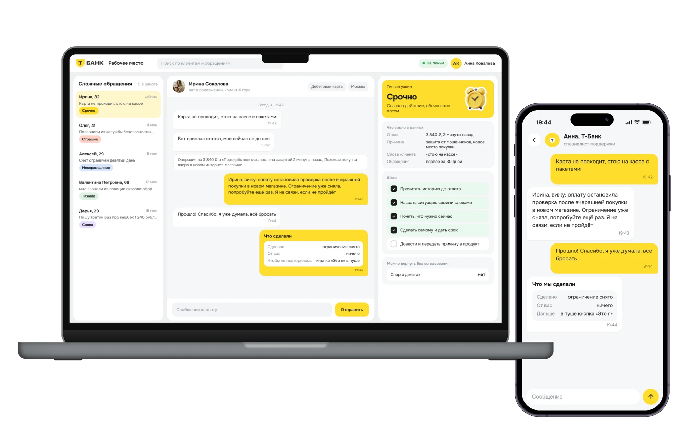
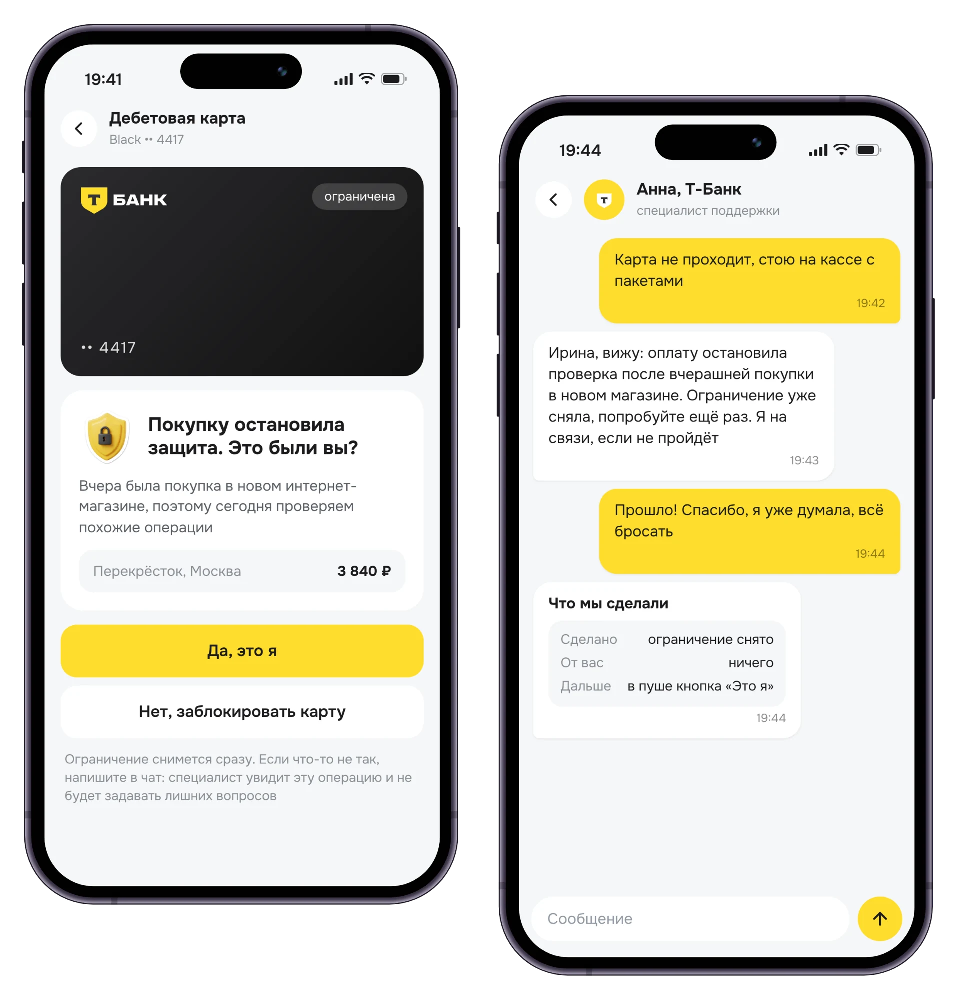
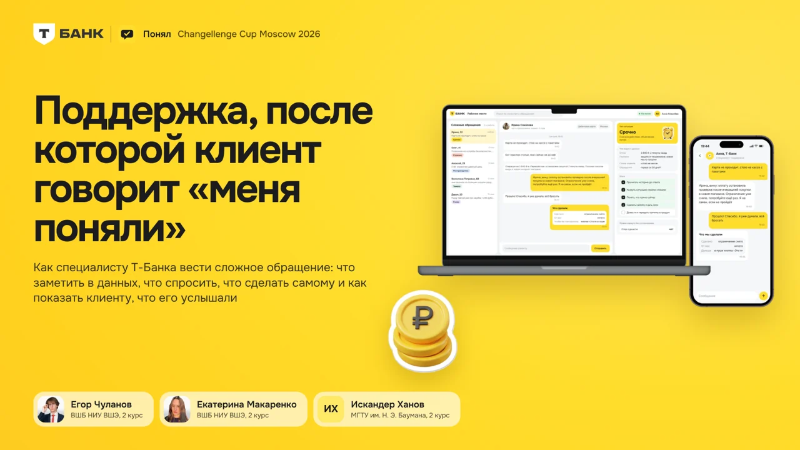
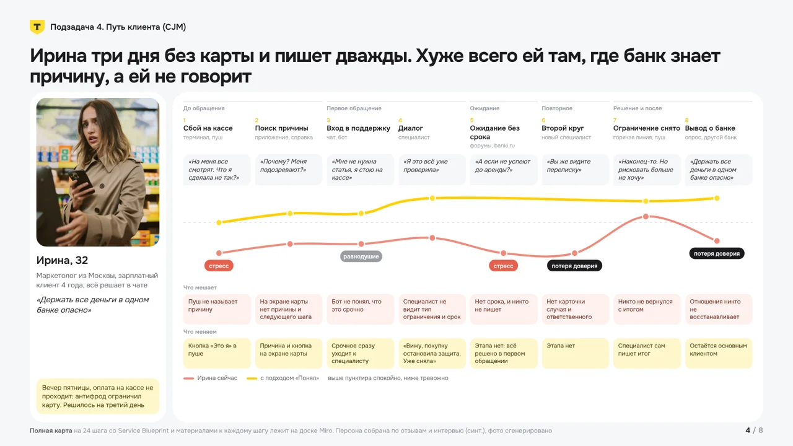
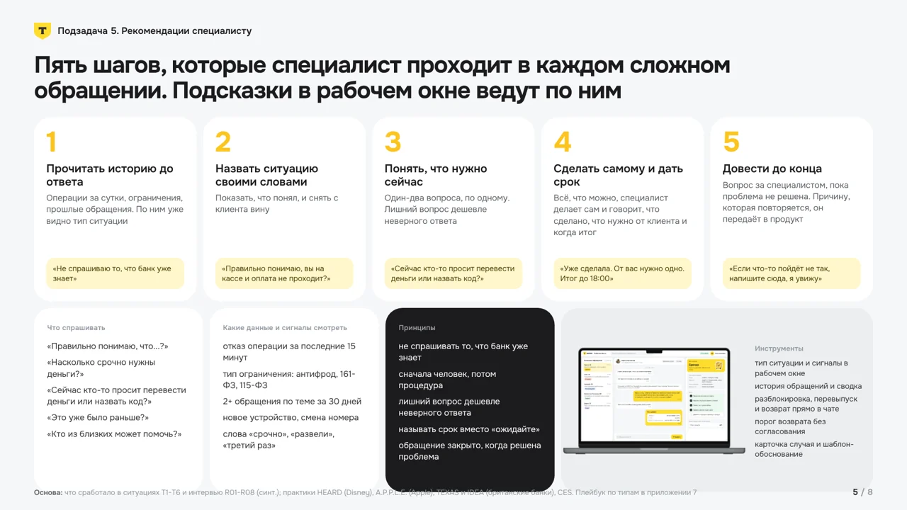
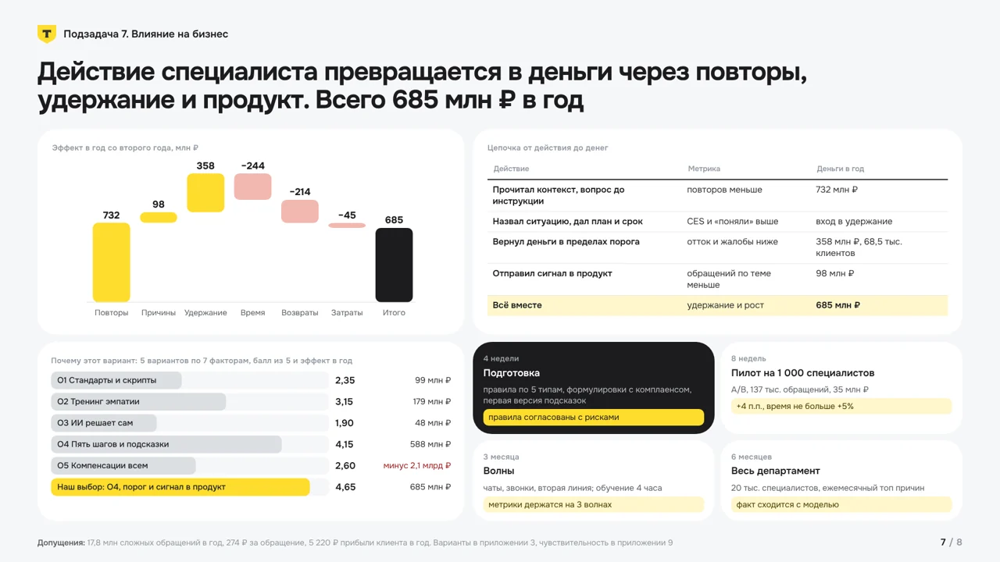

<div align="center">
  
  <h1>Понял</h1>
  <p>Поддержка, после которой клиент говорит «меня поняли». Решение кейса Т-Банка на Changellenge Cup Moscow 2026</p>

  <p>
    <a href="https://egorchulanov.github.io/Cup-Moscow-2026/"></a>
    <a href="https://egorchulanov.github.io/Cup-Moscow-2026/deck/"></a>
    <a href="https://miro.com/app/board/uXjVEUshVGo=/"></a>
    
    
  </p>
</div>

Кейс: «За сообщением клиента: предложите подход к работе специалиста клиентской поддержки Т-Банка», первый тур.

Решение называется **«Понял»**, это то, что клиент должен почувствовать после обращения. Внутри пять типов сложных ситуаций, пять шагов специалиста (прочитать историю до ответа, назвать ситуацию своими словами, понять, что нужно сейчас, сделать самому и дать срок, довести до конца) и изменения в продукте, которые убирают причину обращений.

<div align="center">
  
  
</div>

## Коротко

| | |
| --- | --- |
| **Проблема** | Рутину закрывает ИИ, к специалисту приходят сложные случаи, и после них клиент пишет снова, жалуется или уходит |
| **Пять типов ситуаций** | Срочно, Страшно, Несправедливо, Тяжело, Снова. Тип понятен по первым 1-2 сообщениям и данным клиента |
| **Пять шагов** | прочитать историю, назвать ситуацию, понять, что нужно сейчас, сделать самому и дать срок, довести до конца |
| **Изменения** | подсказки по типу ситуации, карточка случая в чате, видимый тип ограничения, возврат денег до порога, сигнал в продукт |
| **Эффект** | 685 млн ₽ в год, окупаемость 3,2 месяца, +10 п.п. к решению с первого обращения, 68,5 тыс. клиентов в год остаются |

## Презентация

<div align="center">
  
  
  
  
</div>

## С чего начать

1. [docs/CASE_BRIEF.md](docs/CASE_BRIEF.md): что спрашивает кейс (7 подзадач) и факты из кейса.
2. [docs/REQUIREMENTS.md](docs/REQUIREMENTS.md): формат сдачи, критерии жюри и где в решении ответ на каждую подзадачу.
3. [docs/STATUS.md](docs/STATUS.md): что сделано, что осталось, открытые вопросы. Обновляем после каждой рабочей сессии.

## Сдача

- Один PDF до 18 МБ. Загружает один участник в личном кабинете до **2 ноября 2026, 12:00 МСК**.
- Основная часть: **ровно 8 слайдов**, включая титул и резюме команды. Приложения не ограничены, кладём их в тот же PDF.
- Имя файла: `CupMoscow2026-Т-Банк-<НазваниеКоманды>.pdf`. Excel называется так же.
- Ссылки на облако как решение не принимаются: сайт и доска Miro идут как дополнение.

## Что где лежит

| Папка | Что внутри |
|---|---|
| `docs/` | пересказ кейса, требования, статус, шаблон-обоснование для специалиста, вопросы на Q&A |
| `research/` | вторичные данные с источниками: отзывы, экономика поддержки, лучшие практики, открытые CJM, план поля, синтетические данные |
| `analysis/` | дерево причин, типы ситуаций, варианты решения и их сравнение, пять шагов и плейбук, влияние на бизнес |
| `cjm/` | CJM и Service Blueprint (`cjm.json`), сборка доски Miro |
| `model/` | финансовая модель: `build_model.py` собирает Excel с формулами |
| `site/` | сайт решения с прототипом рабочего места специалиста; `site/deck/` презентация и PDF для сдачи; `site/tools/` сборка 3D, мокапов MacBook и iPhone |

## Правила качества

- Отвечаем строго на вопросы кейса. У каждой из 7 подзадач есть место в презентации, карта в `docs/REQUIREMENTS.md`.
- У каждой цифры есть источник. Факт без источника помечаем как допущение или гипотезу.
- Исследование честное: считаем людей и пишем «N из M». Синтетические данные везде подписаны «синт.» и построены на реальных отзывах.
- Одна логика от начала до конца: проблема, причины на 3-5 уровней, типы ситуаций, 3-5 вариантов, сравнение по одним факторам, выбор, финансы, риски, план, метрики.
- CJM строим по шаблону нашей доски курса UX-исследований ВШЭ: этапы и шаги, дорожки опыта, ниже Service Blueprint. Статусы: Г гипотеза, Н наблюдение, О отзыв или опрос, С вторичный источник.
- На слайде одна главная мысль в заголовке, деловой стиль, без опечаток.

## Стиль текста

- Русский язык, простые формулировки.
- Без длинного тире: запятая, двоеточие или скобки.
- Без декоративных точек-разделителей и стрелок в тексте.

## Git

- Работаем в ветках и сливаем в `main` через pull request.
- Сообщения коммитов на русском, по делу.
- Не коммитим PDF кейса и другие материалы организаторов: кейс конфиденциален, в `docs/CASE_BRIEF.md` лежит наш пересказ.
- Не коммитим персональные данные респондентов, только коды R01, R02.

## Как собрать

```bash
python3 model/build_model.py              # Excel: model/out/*.xlsx
TEAM=<Название> node site/deck/build-pdf.mjs   # PDF для сдачи: site/deck/CupMoscow2026-Т-Банк-<Название>.pdf
python3 cjm/miro_svg.py                   # CJM для доски Miro: cjm/out/*.svg
cd cjm && python3 miro_frames.py          # остальные фреймы доски: cjm/out/2*.svg, 3*.svg
```

Сайт открывается без сборки: `site/index.html`, презентация `site/deck/index.html` (стрелки, пробел, F на весь экран).
Для PDF нужны Node 18+ и Playwright с Chromium, для пересчёта формул Excel нужен LibreOffice.
3D-объекты сайта рендерятся из `site/tools/render3d/` (three.js).
